# TUSK — Class Diagrams

Auto-generated Mermaid class diagrams, one per package (kernel and shared split
by subpackage — 184 classes don't fit one readable diagram). For the
whole-system view see the [block diagram](diagrams/architecture.svg) in
[architecture.md](architecture.md).

Regenerate (public members only) inside the dev container:

```bash
docker compose exec tusk pip install pylint  # provides pyreverse
docker compose exec tusk bash  # then, from the repo root:
pyreverse -o mmd --filter-mode=PUB_ONLY -d /tmp/dg -p kernel_core tusk/kernel/core tusk/kernel/modes tusk/kernel/tools
pyreverse -o mmd --filter-mode=PUB_ONLY -d /tmp/dg -p kernel_agent tusk/kernel/agent/*.py tusk/kernel/agent/{confirmation,guards,planner,runtime,tool_sequence,toolset}
pyreverse -o mmd --filter-mode=PUB_ONLY -d /tmp/dg -p kernel_backends tusk/kernel/agent/backends
pyreverse -o mmd --filter-mode=PUB_ONLY -d /tmp/dg -p shared_contracts tusk/shared/{interfaces,llm,mcp,config,observability} tusk/shared/*.py
pyreverse -o mmd --filter-mode=PUB_ONLY -d /tmp/dg -p shared_schemas tusk/shared/schemas
pyreverse -o mmd --filter-mode=PUB_ONLY -d /tmp/dg -p providers tusk/providers
pyreverse -o mmd --filter-mode=PUB_ONLY -d /tmp/dg -p shells shells composition
pyreverse -o mmd --filter-mode=PUB_ONLY -d /tmp/dg -p adapters adapters
```

then paste the `classes_*.mmd` contents into the sections below.

## Kernel — core

`tusk/kernel` `core`, `modes`, and `tools`: `KernelAPI`, `CommandMode`, `MainAgent`, `ModeSlot`, `ToolRegistry`, `AdapterManager`.

```mermaid
classDiagram
  class AdapterManager {
    adapters_dir : Path
    tool_registry
    primary_desktop_source() str
    start_adapter(adapter_dir: str) None
    start_all() None
    start_watcher() None
  }
  class ClipboardGuard {
  }
  class CodingMode {
    process(state: ModeState, text: str) KernelResponse
    stop(state: ModeState) KernelResponse
  }
  class CommandMode {
    process_command(command: str, kind: str) KernelResponse
  }
  class DictationMode {
    process(state: ModeState, text: str) KernelResponse
    stop(state: ModeState) KernelResponse
  }
  class EditApplier {
    apply(edit: EditOperation, driver: EditorDriver) None
  }
  class EditorDriver {
    goto_line(line_number: int) None
    paste(text: str) None
    press_keys(keys: str) None
    read_buffer() str
    replace_buffer(text: str) None
    select_range(selection: BufferSelection) None
    type_text(text: str) None
  }
  class KernelAPI {
    coding : ModeSlot
    dictation : ModeSlot
    interrupt_token : InterruptToken | None
    llm_registry : LLMRegistry | None
    request_interrupt() None
    submit(text: str, kind: str) KernelResponse
  }
  class KernelToolInstaller {
    install(kernel: KernelAPI) None
  }
  class MainAgent {
    process_command(command: str, kind: str) str
  }
  class ModeGate {
    for_mode(llm_registry: LLMRegistry | None, mode_name: str, log_printer: LogPrinter | None) 'ModeGate'
    should_stop(text: str) bool
  }
  class ModeSlot {
    active : bool
    attach_mode(mode: CodingMode | DictationMode) None
    process_text(text: str) KernelResponse
    request_stop() KernelResponse
    set_callbacks(on_start: Callable[[], None], on_stop: Callable[[], None]) None
    start(state: ModeState) KernelResponse
    stop() None
  }
  class ModeState {
    adapter_name : str
    desktop_source : str
    session_id : str
  }
  class RegisteredTool {
    description : str
    execute : Callable[[dict], ToolResult]
    input_schema : dict
    name : str
    planner_visible : bool
    sequence_callable : bool
    settle_ms : int
    source : str
  }
  class SlidingWindowHistory {
    append(message: ChatMessage) None
    clear() None
    get_messages() list[ChatMessage]
  }
  class StartCodingTool {
    description : str
    input_schema : dict
    name : str
    source : str
    execute(parameters: dict) ToolResult
  }
  class StartDictationTool {
    description : str
    input_schema : dict
    name : str
    source : str
    execute(parameters: dict) ToolResult
  }
  class SwitchModelTool {
    description : str
    input_schema : dict
    name : str
    source : str
    execute(parameters: dict) ToolResult
  }
  class ToolRegistry {
    all_tools() list[RegisteredTool]
    definitions_for(names: set[str]) list[dict[str, object]]
    get(name: str) RegisteredTool
    planner_tools() list[RegisteredTool]
    register(tool: object) None
    resolve_name(name: str) str
    tool_names() set[str]
  }
  ToolRegistry --o AdapterManager : tool_registry
```



## Kernel — agent

`tusk/kernel/agent` without `backends`: orchestrator, runtime, profiles, guards, planner, tool sequences, session store.

```mermaid
classDiagram
  class AgentOrchestrator {
    run(request: AgentRunRequest) AgentResult
  }
  class AgentProfile {
    llm_provider : LLMProvider
    max_steps : int
    profile_id : str
    runtime_allowed_tool_names : tuple[str, ...]
    static_tool_names : tuple[str, ...]
    system_prompt : str
  }
  class AgentResult {
    artifact_refs : list[dict[str, str]]
    payload : dict[str, object]
    session_id : str
    status : str
    summary : str
    text : str
    reply_text() str
    to_dict() dict[str, object]
  }
  class AgentRunRequest {
    execution_mode : str
    gate_command : bool
    instruction : str
    metadata : dict[str, object]
    parent_call_id : str
    parent_session_id : str
    profile_id : str
    runtime_tool_names : tuple[str, ...]
    sequence_plan : ToolSequencePlan | None
    session_id : str
    session_refs : tuple[str, ...]
  }
  class AgentRuntime {
    run(request: AgentRunRequest, profile: AgentProfile, tools: list[dict[str, object]], executor: Callable[[ToolCall, str], ToolResult]) AgentResult
  }
  class CallTool {
    definition(tools: list[RegisteredTool]) dict[str, object]
    unwrap(tool_call: ToolCall) ToolCall
  }
  class ConfirmationGate {
    execute(tool_name: str, arguments: dict[str, object]) ToolResult
    resolve(text: str) KernelResponse | None
    take_question() str | None
  }
  class ConsecutiveTypingGuard {
    observe(tool_call: ToolCall, tool_result: ToolResult) None
    refusal(profile_id: str, tool_call: ToolCall) str | None
  }
  class ConversationDelegationGuard {
    observe(tool_call: ToolCall, tool_result: ToolResult) None
    violation(profile_id: str, tool_call: ToolCall) str | None
  }
  class Delegation {
    child_lineage(request: AgentRunRequest, session_id: str, lineage: Lineage) Lineage
    finished(parent_session_id: str, profile_id: str, result: AgentResult) None
    invalid_request() ToolResult
    refusal(request: AgentRunRequest, profile: AgentProfile | None, lineage: Lineage, runtime_names: set[str]) AgentResult | None
    request(tool_call: ToolCall, parent_session_id: str) AgentRunRequest
    result(profile_id: str, agent_result: AgentResult) ToolResult
    started(parent_session_id: str, child: AgentRunRequest) None
  }
  class DestructiveActionPolicy {
    describe(tool_name: str, arguments: dict[str, object]) str | None
  }
  class Executor {
    execute_plan(session_id: str, plan: ToolSequencePlan | None, allowed: set[str]) ToolResult
  }
  class ExecutorClipboardGuard {
    observe(tool_call: ToolCall, tool_result: ToolResult) None
    violation(profile_id: str, tool_call: ToolCall) str | None
  }
  class OrchestratorToolDispatcher {
    dispatch(tool_call: ToolCall, session_id: str, allowed_tool_names: set[str] | None, sequence_plan: ToolSequencePlan | None) ToolResult
  }
  class PendingAction {
    arguments : dict[str, object]
    created_at : float
    follows_active_window : bool
    target_window : str
    tool_name : str
  }
  class PlanValidator {
    validate_sequence(plan: ToolSequencePlan, allowed_tool_names: set[str]) str | None
    validate_steps(plan: ToolSequencePlan) str | None
  }
  class Recorder {
    finished(session_id: str, status: str, summary: str) None
    requested(session_id: str, step_id: str, tool_name: str, args: dict[str, object]) None
    result(session_id: str, step_id: str, tool_name: str, result: ToolResult) None
    started(session_id: str, goal: str) None
  }
  class RepeatedToolCallGuard {
    repeated(tool_call: ToolCall) bool
  }
  class ResultFactory {
    cancelled(session_id: str) AgentResult
    failed(session_id: str, reason: str) AgentResult
    from_parameters(session_id: str, parameters: dict[str, object]) AgentResult
    model_failure_text(exc: Exception) str
    persist(session_id: str, result: AgentResult, reply: str) AgentResult
  }
  class ResultValidator {
    validate(profile_id: str, result: AgentResult, registry: ToolRegistry) AgentResult
  }
  class RuntimeToolResolver {
    resolve(request: AgentRunRequest, real_names: set[str]) AgentRunRequest
  }
  class SessionStore {
    append_event(session_id: str, event_type: str, data: dict[str, object]) None
    conversation_messages(session_id: str) list[dict[str, str]]
    create_session_id() str
    final_result(session_id: str) AgentResult | None
    has_session(session_id: str) bool
    session_digest(session_id: str) str
    start_session(session_id: str, profile_id: str, parent_session_id: str, parent_call_id: str, metadata: dict[str, object]) None
  }
  class SimpleSchemaValidator {
    validate(schema: dict[str, object], value: object) str | None
  }
  class ToolCatalog {
    list_tools() ToolResult
    prompt_text() str
  }
  class ToolsetBuilder {
    build(profile: AgentProfile, request: AgentRunRequest) list[dict[str, object]]
    runtime_names(profile: AgentProfile, request: AgentRunRequest) set[str]
  }
  class Transcript {
    append_message(session_id: str, role: str, content: str) None
    appended(messages: list[dict[str, str]], tool_call: ToolCall, tool_result: ToolResult) None
    build(session_id: str, request: AgentRunRequest) list[dict[str, str]]
    requested(session_id: str, step: int, tool_call: ToolCall) None
    result(session_id: str, step: int, tool_call: ToolCall, tool_result: ToolResult) None
  }
  class TurnGuards {
    observe(tool_call: ToolCall, tool_result: ToolResult) None
    partial_done(profile_id: str) ToolCall | None
    refusal(profile_id: str, tool_call: ToolCall) ToolResult | None
    violation(profile_id: str, tool_call: ToolCall) str | None
  }
```



## Kernel — agent backends

`tusk/kernel/agent/backends`: `AgentBackend` implementations (TUSK, codex exec, codex MCP, fallback).

```mermaid
classDiagram
  class AgentBackend {
    run(request: BackendRequest)* BackendResult
  }
  class AgentBackendFactory {
    create() AgentBackend
  }
  class BackendRequest {
    context : dict[str, object]
    environment : dict[str, str]
    metadata : dict[str, object]
    mode : str
    session_id : str
    timeout_seconds : float | None
    user_text : str
    working_directory : str
  }
  class BackendResult {
    handled : bool
    metadata : dict[str, object]
    raw_output : Optional[object]
    reply : str
    session_id : str
    status : str
  }
  class BackendRunLogger {
    end(request: BackendRequest, started_at: float, result: BackendResult) None
    failure(request: BackendRequest, started_at: float, status: str, error: str) None
    schema(request: BackendRequest, success: bool, detail: str) None
    start(request: BackendRequest) float
  }
  class CallBuilder {
    build(prompt: str, working_directory: str, thread_id: str) tuple[str, dict]
  }
  class Client {
    call_tool(name: str, arguments: dict) dict
    is_running() bool
    stop() None
  }
  class CodexExecAgentBackend {
    name : str
    run(request: BackendRequest) BackendResult
  }
  class CodexMcpAgentBackend {
    name : str
    run(request: BackendRequest) BackendResult
  }
  class CodexPromptBuilder {
    build(request: BackendRequest) str
  }
  class CommandBuilder {
    build(prompt: str) list[str]
  }
  class FallbackAgentBackend {
    name : str
    run(request: BackendRequest) BackendResult
  }
  class ResultMapper {
    failure(request: BackendRequest, message: str, status: str) BackendResult
    success(request: BackendRequest, payload: dict) BackendResult
  }
  class ResultParser {
    parse(output: str) dict | None
  }
  class TuskAgentBackend {
    name : str
    run(request: BackendRequest) BackendResult
  }
  CodexExecAgentBackend --|> AgentBackend
  CodexMcpAgentBackend --|> AgentBackend
  FallbackAgentBackend --|> AgentBackend
  TuskAgentBackend --|> AgentBackend
```



## Shared — contracts

`tusk/shared` ABCs and infrastructure: interfaces (LLM/STT/TTS/log/status/tracing), LLM, MCP, config, observability.

```mermaid
classDiagram
  class AdapterEnvironmentBuilder {
    base_env() dict
    build(path: Path, manifest: dict) dict
  }
  class AdapterWatcher {
    on_created(event) None
  }
  class ColorLogPrinter {
    clear_wait()* None
    log(tag: str, message: str, group: str | None) None
    show_wait(label: str, group: str) None
  }
  class Config {
    ack_enabled : bool
    adapter_env_cache_dir : str
    agent_backend : str
    agent_backend_fallback : str
    agent_session_log_dir : str
    audio_frame_duration_ms : int
    audio_sample_rate : int
    codex_exec_binary : str
    codex_exec_extra_args : tuple[str, ...]
    codex_exec_log_raw_events : bool
    codex_exec_model : str
    codex_exec_output_schema_path : str
    codex_exec_sandbox_mode : str
    codex_exec_timeout_seconds : int
    codex_exec_workdir : str
    command_agent_llm : LLMSlotConfig
    conversation_agent_llm : LLMSlotConfig
    default_agent_llm : LLMSlotConfig
    executor_agent_llm : LLMSlotConfig
    follow_up_timeout_seconds : float
    gate_recovery_candidate_limit : int
    gate_recovery_window_seconds : float
    gatekeeper_llm : LLMSlotConfig
    groq_api_key : str
    max_follow_up_timeout_seconds : float
    openrouter_api_key : str
    planner_agent_llm : LLMSlotConfig
    shells : list[str]
    stop_gate_llm : LLMSlotConfig
    stt_app_vocabulary : bool
    stt_engine : str
    tray_icon_theme : str
    tray_show_last_activity : bool
    tts_enabled : bool
    tts_model : str
    tts_url : str
    tts_voice : str
    utility_llm : LLMSlotConfig
    vad_aggressiveness : int
    vad_silence_ms : int
    whisper_model_size : str
    from_env() 'Config'
  }
  class ConfigFactory {
    build() Config
  }
  class FuzzyNameMatcher {
    candidates(query: str, names: list[str], limit: int) list[str]
    closest(query: str, names: list[str]) str | None
  }
  class InterruptToken {
    is_interrupted : bool
    clear() None
    interrupt() None
  }
  class LLMPayloadLogger {
    before_request(provider: str, payload: dict[str, object]) None
    log_response(response: str | ToolCall) None
  }
  class LLMProvider {
    label : str
    complete(system_prompt: str, user_message: str, max_tokens: int)* str
    complete_messages(system_prompt: str, messages: list[dict])* str
    complete_structured(system_prompt: str, user_message: str, schema_name: str, schema: dict, max_tokens: int)* str
    complete_tool_call(system_prompt: str, messages: list[dict], tools: list[dict[str, object]])* ToolCall
    set_payload_logger(logger: 'LLMPayloadLogger')* None
  }
  class LLMProviderFactory {
    create(provider_name: str, model: str)* LLMProvider
  }
  class LLMProxy {
    label : str
    complete(system_prompt: str, user_message: str, max_tokens: int) str
    complete_messages(system_prompt: str, messages: list[dict]) str
    complete_structured(system_prompt: str, user_message: str, schema_name: str, schema: dict, max_tokens: int) str
    complete_tool_call(system_prompt: str, messages: list[dict], tools: list[dict[str, object]]) ToolCall
    swap(provider: LLMProvider) None
  }
  class LLMRegistry {
    slot_names : list[str]
    get(name: str) LLMProvider
    get_with_fallback(name: str, fallback_name: str) LLMProvider
    model_labels() tuple[tuple[str, str], ...]
    register_slot(name: str, proxy: LLMProxy) None
    swap(slot_name: str, provider_name: str, model: str) str
  }
  class LLMRegistryBuilder {
    build() LLMRegistry
  }
  class LLMRetryRunner {
    run(operation: Callable[[], T], on_retry: RetryListener | None) T
  }
  class LatencyMeter {
    mark_speech_end(seconds_ago: float) None
    mark_tool_call() None
  }
  class LogPrinter {
    clear_wait()* None
    log(tag: str, message: str, group: str | None)* None
    show_wait(label: str, group: str)* None
  }
  class MCPClient {
    call_tool(name: str, arguments: dict) MCPToolResult
    connect_stdio(command: list[str], cwd: str, env: dict | None) None
    is_running() bool
    list_tools() list[MCPToolSchema]
    shutdown() None
  }
  class MCPStdioServer {
    serve() None
  }
  class MCPStdioTransport {
    is_running() bool
    read_line() str | None
    stderr_text() str
    stop() None
    write_line(line: str) None
  }
  class MCPToolProxy {
    description
    input_schema
    name
    planner_visible : bool
    sequence_callable : bool
    settle_ms : int
    source : str
    execute(parameters: dict) ToolResult
  }
  class NullSpanHandle {
    set_attribute(key: str, value: str) None
  }
  class NullStatusSink {
    publish(snapshot: StatusSnapshot) None
  }
  class NullTracer {
    span(name: str, attributes: dict[str, str]) Iterator[SpanHandle]
  }
  class OTelSpanHandle {
    set_attribute(key: str, value: str) None
  }
  class OTelTracer {
    span(name: str, attributes: dict[str, str]) Iterator[SpanHandle]
  }
  class RotatingLLMProvider {
    label : str
    complete(system_prompt: str, user_message: str, max_tokens: int) str
    complete_messages(system_prompt: str, messages: list[dict]) str
    complete_structured(system_prompt: str, user_message: str, schema_name: str, schema: dict, max_tokens: int) str
    complete_tool_call(system_prompt: str, messages: list[dict], tools: list[dict[str, object]]) ToolCall
    set_payload_logger(logger: LLMPayloadLogger) None
  }
  class STTEngine {
    transcribe(audio_frames: bytes, sample_rate: int)* Utterance
  }
  class Shell {
    start(submit: Callable[[str], KernelResponse])* None
  }
  class SpanHandle {
    set_attribute(key: str, value: str)* None
  }
  class StartupOptions {
    hidden_groups : frozenset[str]
    llm_log_preview_chars : int
    log_groups : frozenset[str]
    version : bool
    from_sources(argv: list[str] | None, environ: dict[str, str] | None) 'StartupOptions'
  }
  class StatusReporter {
    status : AppStatus
    attach_sink(sink: StatusSink) None
    set_latency_median_ms(median_ms: int) None
    set_mic_device(device: str) None
    set_mode(mode: AppMode) None
    set_models(models: tuple[tuple[str, str], ...]) None
    set_status(status: AppStatus, detail: str) None
  }
  class StatusSink {
    publish(snapshot: StatusSnapshot)* None
  }
  class TTSEngine {
    synthesize_chunks(text: str)* Iterator[bytes]
  }
  class ToolNameNormalizer {
    name(raw: object) str
    tool_call(tool_call: ToolCall) ToolCall
  }
  class Tracer {
    span(name: str, attributes: dict[str, str])* AbstractContextManager[SpanHandle]
  }
  class TracerFactory {
    create(otlp_endpoint: str, service_name: str) Tracer
  }
  LLMProxy --|> LLMProvider
  RotatingLLMProvider --|> LLMProvider
  ColorLogPrinter --|> LogPrinter
  NullSpanHandle --|> SpanHandle
  NullStatusSink --|> StatusSink
  NullTracer --|> Tracer
  OTelSpanHandle --|> SpanHandle
  OTelTracer --|> Tracer
```



## Shared — schemas

`tusk/shared/schemas`: dataclasses passed between layers.

```mermaid
classDiagram
  class AppEntry {
    categories : tuple[str, ...]
    desktop_id : str
    exec_cmd : str
    generic_name : str
    keywords : tuple[str, ...]
    name : str
  }
  class AppMode {
    name
  }
  class AppStatus {
    name
  }
  class BufferSelection {
    end_line : int
    start_line : int
  }
  class BufferedUtterance {
    dropped : bool
    id : str
    received_at : float
    text : str
    utterance
  }
  class ChatMessage {
    content : str
    role : str
    to_dict() dict[str, str]
  }
  class DesktopContext {
    active_application : str
    active_window_title : str
    available_applications : list[object]
    open_windows : list[WindowInfo]
  }
  class EditOperation {
    full_buffer : str
    kind : str
    new_text : str
    target_end : int
    target_start : int
  }
  class GateAction {
    name
  }
  class GateClassification {
    name
  }
  class GateDispatch {
    action
    intent : str
    kind : str
    recovered_id : str
    text : str | None
  }
  class GateResult {
    classification
    cleaned_command : str
    confidence : float
    intent : str
    is_directed_at_tusk : bool
  }
  class KernelResponse {
    handled : bool
    reply : str
  }
  class LLMSlotConfig {
    model : str
    provider_name : str
    rotation : tuple[str, ...]
    parse(value: str) 'LLMSlotConfig'
  }
  class MCPToolResult {
    content : str
    data : dict | None
    is_error : bool
  }
  class MCPToolSchema {
    description : str
    input_schema : dict
    name : str
  }
  class RecoveryDecision {
    action : str
    candidate_id : str
    reason : str
  }
  class StatusSnapshot {
    detail : str
    latency_median_ms : int | None
    mic_device : str
    mode
    models : tuple[tuple[str, str], ...]
    status
  }
  class ToolCall {
    call_id : str
    parameters : dict[str, object]
    tool_name : str
  }
  class ToolResult {
    data : dict | None
    message : str
    success : bool
  }
  class ToolSequencePlan {
    goal : str
    steps : tuple[ToolSequenceStep, ...]
    from_dict(data: object) 'ToolSequencePlan | None'
    ordered_tool_names() tuple[str, ...]
    to_dict() dict[str, object]
    tool_names() set[str]
  }
  class ToolSequenceStep {
    args : dict[str, object]
    step_id : str
    tool_name : str
    from_dict(data: object) 'ToolSequenceStep | None'
    to_dict() dict[str, object]
  }
  class Utterance {
    audio_frames : bytes
    confidence : float
    duration_seconds : float
    text : str
  }
  class WindowInfo {
    application : str
    height : int
    is_active : bool
    title : str
    width : int
    window_id : str
    x : int
    y : int
  }
  StatusSnapshot --> AppMode : mode
  StatusSnapshot --> AppStatus : status
  GateDispatch --> GateAction : action
  GateResult --> GateClassification : classification
  BufferedUtterance --> Utterance : utterance
```



## Providers

`tusk/providers`: swappable LLM/STT/TTS implementations.

```mermaid
classDiagram
  class ChatCompletionsLLM {
    label : str
    complete(system_prompt: str, user_message: str, max_tokens: int) str
    complete_messages(system_prompt: str, messages: list[dict]) str
    complete_structured(system_prompt: str, user_message: str, schema_name: str, schema: dict, max_tokens: int) str
    complete_tool_call(system_prompt: str, messages: list[dict], tools: list[dict[str, object]]) ToolCall
    set_payload_logger(logger: LLMPayloadLogger) None
  }
  class ConfigurableLLMFactory {
    create(provider_name: str, model: str) LLMProvider
  }
  class GroqLLM {
    verify() None
  }
  class GroqSTT {
    transcribe(audio_frames: bytes, sample_rate: int) Utterance
  }
  class GroqTTS {
    synthesize_chunks(text: str) Iterator[bytes]
  }
  class OpenAICompatibleTTS {
    synthesize_chunks(text: str) Iterator[bytes]
  }
  class OpenRouterLLM {
  }
  class STTEngineFactory {
    create(name: str) STTEngine
  }
  class TextChunker {
    split(text: str) list[str]
  }
  class ToolUseFailedRecovery {
    recover(exc: Exception) ToolCall | None
  }
  class WhisperSTT {
    transcribe(audio_frames: bytes, sample_rate: int) Utterance
  }
  GroqLLM --|> ChatCompletionsLLM
  OpenRouterLLM --|> ChatCompletionsLLM
```



## Shells

`shells` and `composition`: voice, CLI, tray, emulator front-ends and the composition root.

```mermaid
classDiagram
  class AppIndicatorTrayBackend {
    run() None
    set_icon(name: str) None
    set_menu(items: tuple[TrayMenuItem, ...]) None
    set_tooltip(text: str) None
    stop() None
  }
  class AudioCapture {
    stream_frames() Iterator[bytes]
  }
  class CLIShell {
    start(submit: Callable[[str], KernelResponse]) None
  }
  class ChunkedSpeaker {
    current_text : str | None
    recent_speech() list[tuple[str, float]]
    speak(text: str) None
  }
  class CommandWorker {
    current_speech_text : str | None
    is_busy : bool
    recent_speech : list[tuple[str, float]]
    enqueue(text: str, refrain: str, kind: str) None
    flush() None
    start() None
  }
  class ConfirmationAnswerGate {
    process(utterance: BufferedUtterance, recent: list[Utterance], candidates: list[BufferedUtterance]) GateDispatch
  }
  class ConfirmationReply {
    answer(text: str) str | None
  }
  class EchoFilter {
    process(utterance: Utterance) Utterance | None
  }
  class EmulatorShell {
    start(submit: Callable[[str], KernelResponse]) None
  }
  class Gatekeeper {
    process(utterance: BufferedUtterance, recent: list[Utterance], candidates: list[BufferedUtterance])* GateDispatch
  }
  class GatekeeperBuilder {
    gatekeeper(worker: CommandWorker) GatekeeperSlot
  }
  class GatekeeperSlot {
    process(utterance: BufferedUtterance, recent: list[Utterance], candidates: list[BufferedUtterance]) GateDispatch
    swap(gatekeeper: Gatekeeper) None
  }
  class LLMClient {
    complete(prompt: str, text: str, name: str, schema: dict, max_tokens: int) dict[str, object]
    primary(prompt: str, text: str) GateResult
    recovery(prompt: str, text: str, candidates: list[BufferedUtterance]) RecoveryDecision
  }
  class LLMGatekeeper {
    process(utterance: BufferedUtterance, recent: list[Utterance], candidates: list[BufferedUtterance]) GateDispatch
  }
  class PlaybackGate {
    process(utterance: BufferedUtterance, recent: list[Utterance], candidates: list[BufferedUtterance]) GateDispatch
  }
  class Sanitizer {
    process(utterance: Utterance) Utterance | None
  }
  class ShellLoader {
    start() None
  }
  class SpeechPlayback {
    play(wav_bytes: bytes) None
  }
  class SpeechStopGate {
    should_stop(text: str, speaking: str) bool
  }
  class StopGatekeeper {
    process(utterance: BufferedUtterance, recent: list[Utterance], candidates: list[BufferedUtterance]) GateDispatch
  }
  class Transcriber {
    process(utterance: Utterance) Utterance
  }
  class TranscriptionBuffer {
    mark_dropped(entry_id: str) None
    mark_recovered(entry_id: str) None
    process(utterance: Utterance) BufferedUtterance
    recent(count: int) list[Utterance]
    recoverable(count: int, max_age_seconds: float) list[BufferedUtterance]
  }
  class TrayBackend {
    run()* None
    set_icon(name: str)* None
    set_menu(items: tuple[TrayMenuItem, ...])* None
    set_tooltip(text: str)* None
    stop()* None
  }
  class TrayMenuItem {
    action : Callable[[], None] | None
    children : tuple['TrayMenuItem', ...]
    enabled : bool
    label : str
  }
  class TrayShell {
    start(submit: Callable[[str], KernelResponse]) None
    stop() None
  }
  class TrayStatusSink {
    icon_path(status: AppStatus) str
    publish(snapshot: StatusSnapshot) None
  }
  class UtteranceDetector {
    stream_utterances() Iterator[Utterance]
  }
  class VoicePipeline {
    run(submit: Callable[[str, str, str], KernelResponse | None]) Iterator[KernelResponse]
  }
  class VoiceShell {
    pause() None
    resume() None
    start(submit: Callable[[str], KernelResponse]) None
  }
  class VoiceShellBuilder {
    build() VoiceShell
    stt_engine() STTEngine
    tts_engine() TTSEngine
    worker() CommandWorker
  }
  AppIndicatorTrayBackend --|> TrayBackend
  ConfirmationAnswerGate --|> Gatekeeper
  GatekeeperSlot --|> Gatekeeper
  LLMGatekeeper --|> Gatekeeper
  PlaybackGate --|> Gatekeeper
  StopGatekeeper --|> Gatekeeper
```




## Adapters

`adapters`: MCP servers (gnome, dictation, coding).

```mermaid
classDiagram
  class AppCatalog {
    list_apps() list[AppEntry]
    search(query: str, limit: int) list[AppEntry]
    suggest(query: str, limit: int) list[str]
  }
  class AppVocabulary {
    installed() 'AppVocabulary'
    stt_prompt(enabled: bool) str
    text() str
  }
  class ApplicationTools {
    launch_application(arguments: dict) dict
    open_uri(arguments: dict) dict
    search_applications(arguments: dict) dict
  }
  class ClipboardTools {
    read_clipboard(arguments: dict) dict
    write_clipboard(arguments: dict) dict
  }
  class CodingEditPlanner {
    plan(intent: str, buffer_text: str) str | None
  }
  class CodingServer {
    serve() None
  }
  class ContextTools {
    get_active_window(arguments: dict) dict
    get_desktop_context(arguments: dict) dict
    list_windows(arguments: dict) dict
  }
  class DictationServer {
    serve() None
  }
  class DictationSessionStore {
    get(session_id: str) str
    pop(session_id: str) None
    prune_stale() None
    set(session_id: str, text: str) None
  }
  class GnomeClipboardProvider {
    read() str
    write(text: str) None
  }
  class GnomeToolRouter {
    call(name: str, arguments: dict) dict
    schemas() dict[str, dict]
  }
  class InputTools {
    mouse_click(arguments: dict) dict
    mouse_drag(arguments: dict) dict
    mouse_move(arguments: dict) dict
    mouse_scroll(arguments: dict) dict
    press_keys(arguments: dict) dict
    replace_recent_text(arguments: dict) dict
    type_text(arguments: dict) dict
  }
  class LaunchedWindowGuard {
    ensure_active() str | None
    remember(window_id: str, title: str) None
  }
  class ShellBus {
    call(method: str, arguments: list[object]) str
    call_string(method: str) str
  }
  class ToolSchemaCatalog {
    build() dict[str, dict]
  }
  class WaylandContextProvider {
    get_context() DesktopContext
  }
  class WaylandInputSimulator {
    mouse_click(x: int, y: int, button: int, clicks: int) None
    mouse_drag(from_x: int, from_y: int, to_x: int, to_y: int, button: int) None
    mouse_move(x: int, y: int) None
    mouse_scroll(direction: str, clicks: int) None
    press_keys(keys: str) None
    replace_text(char_count: int, text: str) None
  }
  class WaylandWindowTools {
    active_window_id() str
    close_window(arguments: dict) dict
    focus(window_id: str) None
    focus_window(arguments: dict) dict
    list_windows() list[tuple[str, str, str]]
    maximize_window(arguments: dict) dict
    minimize_window(arguments: dict) dict
    move_resize_window(arguments: dict) dict
    switch_workspace(arguments: dict) dict
    tile_window(arguments: dict) dict
  }
  class WindowTools {
    close_window(arguments: dict) dict
    focus_window(arguments: dict) dict
    maximize_window(arguments: dict) dict
    minimize_window(arguments: dict) dict
    move_resize_window(arguments: dict) dict
    switch_workspace(arguments: dict) dict
    tile_window(arguments: dict) dict
  }
  class X11ContextProvider {
    get_context() DesktopContext
  }
  class X11InputSimulator {
    mouse_click(x: int, y: int, button: int, clicks: int) None
    mouse_drag(from_x: int, from_y: int, to_x: int, to_y: int, button: int) None
    mouse_move(x: int, y: int) None
    mouse_scroll(direction: str, clicks: int) None
    press_keys(keys: str) None
    replace_text(char_count: int, text: str) None
    type_text(text: str) None
  }
  class X11Windows {
    active_window_id() str
    focus(window_id: str) None
    list_windows() list[tuple[str, str, str]]
  }
  WaylandInputSimulator --|> X11InputSimulator
  WaylandWindowTools --|> WindowTools
```


